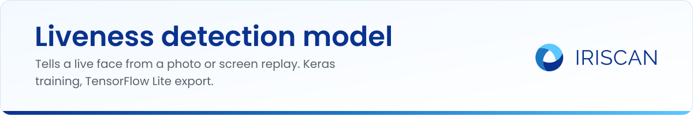
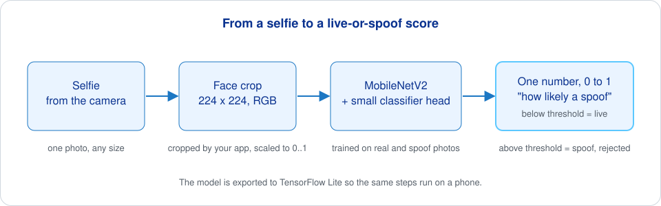
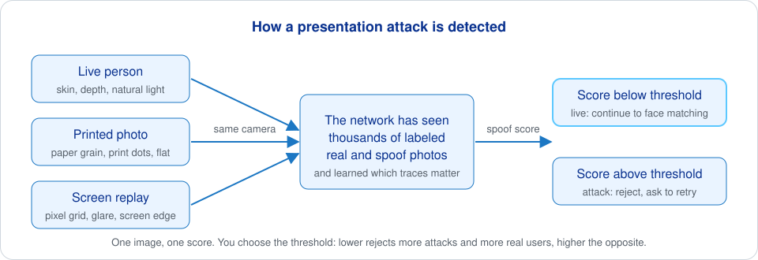

# Liveness detection model

Training code for a face liveness check: a small neural network that looks at one face photo and tells whether it shows a live person or a presentation attack, such as a printed photo or a phone screen held up to the camera. It is the kind of check you run before face enrollment or verification, so that a photo of the right person is not accepted as the person. You get a Keras training script, a TensorFlow Lite export and an evaluation script, plus ready-made `.tflite` models in the releases.

[](LICENSE.md)
[](https://github.com/biometric-technologies/liveness-detection-model/releases)

## What it does

- Trains a MobileNetV2 classifier that returns one number per image: the probability that the image is a spoof.
- Prepares the CelebA-Spoof dataset into `real` and `spoof` folders and resizes images to a square.
- Exports the trained model to TensorFlow Lite, so it can run on phones and in the [Biometric SDK](https://github.com/biometric-technologies/biometric-sdk).
- Scores a test folder with a `.tflite` model at a chosen threshold and writes the results to a CSV file.
- Runs a grid of trainings over epochs, steps and thresholds in one command.



## Quick start

You need Python 3.9. TensorFlow 2.13.0 and Keras 2.13.1 are pinned in `requirements.txt`; `train.py` also needs `matplotlib`, which is not listed there.

```bash
pip3 install -r requirements.txt matplotlib
```

Put your images in this layout (class folders must be named `real` and `spoof`):

```text
data_resized/
├── train/
│   ├── real/
│   └── spoof/
├── valid/
│   ├── real/
│   └── spoof/
└── test/
    ├── real/
    └── spoof/
```

Train, export and test:

```bash
# 1. Train (defaults: 224 x 224 input, batch 32, 10 epochs, 100 steps per epoch)
python3 train.py --input_data_path data_resized --model_path model

# 2. Export the SavedModel to TensorFlow Lite
python3 tflite.py --saved_model_dir model/saved_model_dir --tflite_file_path model/model.tflite

# 3. Score the test folder at a threshold
python3 test.py --threshold 0.5 --test_dir data_resized/test --model_file model/model.tflite
```

To skip training, download a model from the [releases](https://github.com/biometric-technologies/liveness-detection-model/releases) and run step 3 only.

If you want to try several settings at once, `train_script.py` trains one model per combination of epochs and steps, converts each one and tests it at every threshold:

```bash
python3 train_script.py \
    --list_of_epochs 5 10 \
    --list_of_steps 10 100 \
    --list_of_thresholds 0.01 0.1 0.5 \
    --test_dir data_resized/test
```

Models land in `models/model_<epochs>_<steps>/` and all results in `models/result.csv`.

## How it works

**The model.** `model.py` takes MobileNetV2 with ImageNet weights, without its original top layers, and lets every layer train. On top of it sit a 1x1 convolution with 32 filters, global average pooling, a dense layer of 128 units, dropout 0.3, a dense layer of 64 units, dropout 0.2 and a single sigmoid output. Keras assigns class indices alphabetically, so `real` is 0 and `spoof` is 1: the output is the probability that the image is a spoof. Training uses binary cross-entropy, Adam with learning rate 0.0001, and class weights computed from the number of images in each class, so an unbalanced dataset does not bias the model.

**Training.** `train.py` reads `train` and `valid` from the input folder with Keras image generators. Training images are scaled to [0, 1] and augmented (rotation up to 20 degrees, shifts of 0.2, shear 0.15, zoom 0.15, horizontal flip); validation images are only scaled. The learning rate is cut by a factor of 5 when validation loss stops improving for 3 epochs. After every epoch the full model is saved to `train-weights/mobilenetv2-epoch_NN.hdf5`, the best weights go to `train-weights/mobilenetv2-best.hdf5`, and when training ends the model is written as a SavedModel to `saved_model_dir` with a loss plot in `train_metrics.png`.

**Export.** `tflite.py` converts the SavedModel with the default TensorFlow Lite converter: float32 weights, no quantization. The result expects a 224 x 224 RGB image scaled to [0, 1] and returns one number.

**Evaluation.** `test.py` loads the `.tflite` file, reads every `.png`, `.jpg` or `.bmp` in `test/real` and `test/spoof`, resizes each image to the model input and scales it to [0, 1]. An image with a score below the threshold counts as real, otherwise as spoof. The script prints accuracy, ACER and the false accept and false reject rates, and appends one row to `result.csv`. Two details to know: the rates named FAR and FRR are divided by the total number of images, not by the number of attacks or real images, and images are fed in the BGR order OpenCV reads them while training used RGB. Both are addressed in [pull request #1](https://github.com/biometric-technologies/liveness-detection-model/pull/1).

**Data preparation.** `dataset.py` is written for the `Data` folder of [CelebA-Spoof](https://github.com/ZhangYuanhan-AI/CelebA-Spoof), where each subject has a numbered folder with `live` and `spoof` subfolders. On `main` the script is an early draft that needs the output folders created by hand first; the version in pull request #1 is the one to use.

**How a presentation attack is caught.** Nothing in the code looks for a specific trick. The network sees thousands of labeled real and spoof photos during training and learns the traces a replayed image leaves behind: paper grain and print dots, the pixel grid and glare of a screen, flat lighting, a second border around the face. At run time it turns those traces into one score. The threshold is yours to set: a low threshold rejects more attacks and more real users, a high one the opposite.



### ISO/IEC 30107-3 evaluation (pull request #1)

ISO/IEC 30107-3 is the standard for testing presentation attack detection. It reports APCER (the share of attacks that pass, per attack type, with the worst type counting), BPCER (the share of real users rejected), and operating points such as BPCER at a fixed APCER. The open [pull request #1](https://github.com/biometric-technologies/liveness-detection-model/pull/1) adds these metrics in `pad_metrics.py`, a rewritten `test.py` that reports APCER per attack type, BPCER, ACER, EER and BPCER at APCER 1 %, 5 % and 10 %, a subject-disjoint validation split in `dataset.py`, early stopping on validation AUC, and RGB input at test time. Until it is merged, the usage above describes what is on `main`.

## Numbers

The notes of [release v0.2.0](https://github.com/biometric-technologies/liveness-detection-model/releases/tag/v0.2.0) give this table, produced with the `test.py` of this repository:

| Threshold | 0.01 | 0.1 | 0.5 |
| --- | --- | --- | --- |
| FAR (%) | 3 | 6 | 7 |
| FRR (%) | 5 | 3 | 2 |
| ACC (%) | 90.35 | 90.85 | 90.6 |
| ACER (%) | 9.65 | 9.15 | 9.4 |

Read them with care: FAR and FRR here are error counts divided by all test images, the notes do not say which model file or test set was used, and these figures are not the ISO/IEC 30107-3 metrics described above. For a number you can publish, prepare a test set of people who were not in training, with attacks grouped by type, and score it with the evaluation script from pull request #1.

## Where it is used

The [Biometric SDK](https://github.com/biometric-technologies/biometric-sdk) has a photo liveness check, configured with `LivenessModelPhotoConfiguration(path, inputWidth, inputHeight, threshold)`, where `path` can be a local file or a URL to a `.tflite` model. The SDK letterboxes the image to the configured size, scales pixels to [-1, 1], runs the model and uses the mean of the output as the live score; `validate` accepts when the score is above the threshold. Release v0.2.0 of this repository publishes two files: `model.tflite`, the MobileNetV2 export of this code, and `deePix.tflite`, a DeePixBiS model that matches the SDK's input scaling and output layout. The MobileNetV2 export is not a drop-in for the SDK: it expects input in [0, 1] and returns the spoof probability, which is the opposite direction of the SDK's live score. The same liveness scoring is exposed to React Native apps through [biometric-sdk-react-native](https://github.com/biometric-technologies/biometric-sdk-react-native).

The `model.tflite` from release v0.2.0 is also the input of the ONNX conversion notebook in [biometric-models-onnx-converters](https://github.com/biometric-technologies/biometric-models-onnx-converters).

## Related repositories

- [biometric-sdk](https://github.com/biometric-technologies/biometric-sdk): Kotlin Multiplatform SDK for JVM, Android and iOS that runs the liveness check.
- [biometric-sdk-react-native](https://github.com/biometric-technologies/biometric-sdk-react-native): React Native bindings with face comparison and liveness scoring.
- [biometric-models-onnx-converters](https://github.com/biometric-technologies/biometric-models-onnx-converters): notebooks that convert this model and FaceNet to ONNX.
- [tensorflow-facenet-model-test](https://github.com/biometric-technologies/tensorflow-facenet-model-test): test harness for the FaceNet TensorFlow Lite model.
- [facenet-recognition-model](https://github.com/biometric-technologies/facenet-recognition-model) and [mtcnn-face-detection-model](https://github.com/biometric-technologies/mtcnn-face-detection-model): reserved for the face embedding and face detection models.
- [docs](https://github.com/biometric-technologies/docs): source of the developer documentation at docs.iriscan.com.

## License

The code is released under the MIT License, copyright (c) 2023 Biometric Technologies OÜ. See [LICENSE.md](LICENSE.md). CelebA-Spoof and any other dataset you train on come with their own terms; check them before shipping a model trained on them.

## Contact

Questions and bug reports: [open an issue](https://github.com/biometric-technologies/liveness-detection-model/issues) or write to info@iriscan.net. More about Iriscan at https://www.iriscan.com.
