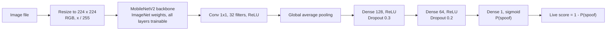
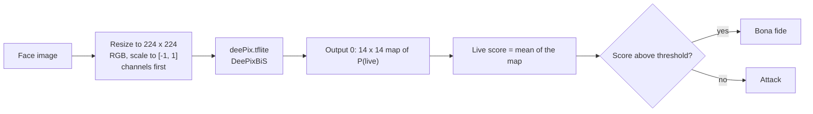

# Face liveness detection models

Training and evaluation code for face presentation attack detection (PAD), the
liveness check of the [Iriscan Biometric SDK](https://github.com/biometric-technologies/biometric-sdk).
Given a single face image, a model returns a score that separates bona fide
presentations (a live person in front of the camera) from presentation attacks
such as printed photos, screen replays or masks. The check is meant to run before
face enrolment or verification, so that a match against a photo of the enrolled
person is not accepted as a real user.

The repository covers two models:

| Model | Role | Produced here |
| --- | --- | --- |
| MobileNetV2 binary classifier ([Zawar et al., 2023](https://www.atlantis-press.com/proceedings/acvait-22/125989871)) | Model trained and exported by this code | Yes: `train.py`, `tflite.py` |
| DeePixBiS ([George and Marcel, 2019](https://arxiv.org/abs/1907.04047)), `deePix.tflite` | The model the Biometric SDK's photo liveness check is written for | No: published as a file in the [v0.2.0 release](https://github.com/biometric-technologies/liveness-detection-model/releases/tag/v0.2.0) |

`test.py` evaluates either model from its `.tflite` file and reports the metrics of
ISO/IEC 30107-3.

## Contents

| File | Purpose |
| --- | --- |
| `dataset.py` | Converts CelebA-Spoof into `train` / `valid` / `test` folders with a subject-disjoint validation split and letterboxes images to a square size |
| `model.py` | MobileNetV2 classifier definition and compilation |
| `train.py` | Trains the classifier and saves checkpoints, a SavedModel and a loss plot |
| `tflite.py` | Converts the SavedModel to TensorFlow Lite |
| `test.py` | Scores a test folder with a `.tflite` model and reports PAD metrics |
| `pad_metrics.py` | APCER, BPCER, EER and BPCER at a fixed APCER |
| `train_script.py` | Grid run: train, convert and test for several epoch, step and threshold values |

## Models

### MobileNetV2 classifier

`model.py` builds a MobileNetV2 backbone with ImageNet weights (`include_top=False`,
every layer trainable) and a small classification head. The sigmoid output is the
probability that the image is an attack: with Keras' alphabetical class order,
`real` is class 0 and `spoof` is class 1. `test.py` converts it to a live score as
`1 - P(spoof)`.



### DeePixBiS (`deePix.tflite`)

DeePixBiS is trained with pixel-wise binary supervision: besides a binary decision
it predicts a map in which every cell estimates whether that part of the face is
live. According to the paper, the network is built on the first dense blocks of
DenseNet-161. This repository contains only the converted TensorFlow Lite file;
its training code and training data are not part of the repository.

The tensors of `deePix.tflite` from release v0.2.0:

| Tensor | Shape | Meaning |
| --- | --- | --- |
| Input | `1 x 3 x 224 x 224`, float32, NCHW | RGB scaled as `(x / 255 - 0.5) / 0.5`, that is to [-1, 1] |
| Output 0 | `1 x 1 x 14 x 14`, float32 | Map of live probabilities |
| Output 1 | `1`, float32 | Scalar output; not used by `test.py` or the SDK |



### Use in the Biometric SDK

The SDK exposes the check as `FaceLivenessPhotoDetection` (`livenessPhoto()` on the
face operations). It is configured with `LivenessModelPhotoConfiguration(path,
inputWidth, inputHeight, threshold)`; `path` can be a local file or an `https` URL,
and the SDK caches the model as `liveness-photo.tflite`. On JVM, Android and iOS the
SDK resizes the image bilinearly to the configured size, scales it to [-1, 1],
reorders it to channels-first and returns the mean of output 0 as the score.
`validate` returns `score > threshold`. `extractAndValidate` and `extractAndScore`
first crop the face with the SDK's face extractor; `validate` and `score` use the
image as given.

```kotlin
val config = BiometricSdkConfigBuilder()
    .withFace(
        liveness = FaceLivenessDetectionProperties(
            photo = LivenessModelPhotoConfiguration(
                path = "https://github.com/biometric-technologies/liveness-detection-model/releases/download/v0.2.0/deePix.tflite",
                inputWidth = 224,
                inputHeight = 224,
                threshold = livenessThreshold  // chosen from your own evaluation, see below
            ),
            position = null
        )
    )
    .build()
```

The MobileNetV2 model exported by `tflite.py` is not a drop-in replacement for
`deePix.tflite`: it takes a channels-last input scaled to [0, 1] and returns one
attack probability, while the SDK feeds a channels-first input in [-1, 1] and reads a
14 x 14 live map. Deploying it through the SDK requires changing the SDK's
preprocessing and score computation as well.

## Data

### Source layout

`dataset.py` expects the `Data` folder of [CelebA-Spoof](https://github.com/ZhangYuanhan-AI/CelebA-Spoof),
where every subject has a numbered folder with `live` and `spoof` subfolders:

```text
Data/
├── train/
│   ├── <subject id>/
│   │   ├── live/    *.jpg, *.png
│   │   └── spoof/   *.jpg, *.png
│   └── ...
└── test/
    └── <subject id>/
        ├── live/
        └── spoof/
```

### Preparation

```bash
python3 dataset.py --input_dir Data --resized_dir data_resized --target_size 224
```

The script works in two passes:

1. **Regrouping, in place.** Images (`.png`, `.jpg`) are moved from each subject
   folder into `real/` (from `live/`) and `spoof/`, renamed `<subject id>_<file name>`,
   and the subject folder is then deleted together with everything else in it.
   Subjects of `train` whose name has `crc32(name) % 5 == 0` go to a new `valid`
   folder instead, which gives a deterministic validation set of about 20 % of the
   training subjects. No person appears in both `train` and `valid`, so validation
   accuracy is not inflated by identity leakage. The `test` split is kept as
   CelebA-Spoof defines it.
2. **Resizing.** Every image of every split is scaled to fit a
   `target_size x target_size` square with its aspect ratio kept and padded with
   black (letterboxing), then written to `--resized_dir`.

`dataset.py` modifies the input folder: it moves the files and deletes the subject
folders. Run it on a copy of the dataset. Both `--input_dir` and `--resized_dir` are
required.

### Layout used for training

`train.py` reads the result of `dataset.py`:

```text
data_resized/
├── train/
│   ├── real/
│   └── spoof/
├── valid/
│   ├── real/
│   └── spoof/
└── test/
    ├── real/
    └── spoof/
```

The class folders must be named `real` and `spoof`: the class index, and therefore
the meaning of the model output, follows their alphabetical order. Any other dataset
can be used if it is arranged the same way and split by subject.

The images are whole frames: `dataset.py` does not crop to the face.

## Training

```bash
python3 train.py --input_data_path data_resized --model_path model
```

| Setting | Value in code | Argument |
| --- | --- | --- |
| Input size | 224 x 224 x 3 | `--img_width`, `--img_height` |
| Pixel scaling | `x / 255` | |
| Backbone | MobileNetV2, ImageNet weights, all layers trainable | |
| Loss | Binary cross-entropy with class weights | |
| Class weights | `w_c = N / (2 * N_c)` from the image counts of `train/real` and `train/spoof` | |
| Optimizer | Adam, learning rate 1e-4 | |
| Batch size | 32 for training, 32 for validation | `--train_batch_size`, `--val_batch_size` |
| Epochs | At most 30 | `--num_epochs` |
| Steps per epoch | Whole training set | `--steps_per_epoch` |
| Validation steps | Whole validation set | `--validation_steps` |
| Learning rate schedule | `ReduceLROnPlateau` on `val_loss`: factor 0.2, patience 3, `min_delta` 0.005, minimum 5e-7 | |
| Early stopping | On validation AUC (`val_auc`), patience 6, `restore_best_weights=True` | |
| Augmentation (training only) | Rotation up to 20 degrees, width and height shift 0.2, shear 0.15, zoom 0.15, horizontal flip, `nearest` fill | |
| Seed | 24, for shuffling and augmentation of the training generator | `--seed_number` |
| Metrics logged | Accuracy and ROC AUC | |

Outputs, under `--model_path` (default `model`):

| Path | Content |
| --- | --- |
| `train-weights/mobilenetv2-epoch_NN.hdf5` | Full model after every epoch |
| `train-weights/mobilenetv2-best.hdf5` | Weights only, of the epoch with the highest validation AUC |
| `saved_model_dir/` | SavedModel of the model when training ends; input for `tflite.py` |
| `train_metrics.png` | Training and validation loss per epoch |

With Keras 2.13, `restore_best_weights` is applied only when early stopping triggers.
If training runs all `--num_epochs` epochs, `saved_model_dir` holds the weights of the
last epoch, and the best epoch is available only in `mobilenetv2-best.hdf5`.

`--batch_size` is parsed but not used. `--img_width` is used as the image height and
`--img_height` as the width; with square inputs, the default, this has no effect.

## Export to TensorFlow Lite

```bash
python3 tflite.py --saved_model_dir model/saved_model_dir --tflite_file_path model/model.tflite
```

`tflite.py` runs `tf.lite.TFLiteConverter.from_saved_model` with default settings:
float32 weights, no quantization. The resulting model has a channels-last input and
one sigmoid output, P(spoof). There is no ONNX export.

## Evaluation

```bash
python3 test.py \
    --model_file model/model.tflite \
    --test_dir data_resized/test \
    --threshold 0.5 \
    --scores_file scores.csv
```

`test.py` loads the `.tflite` file with the TensorFlow Lite interpreter, or with
`ai_edge_litert` when TensorFlow is not installed. It recognises the model kind
from the input shape: a channels-first input is treated as DeePixBiS, anything else
as the MobileNetV2 classifier. Each image is read with OpenCV, resized to the model
input without keeping the aspect ratio, converted to RGB and scaled as that model
expects. All scores are reported as live scores, higher meaning bona fide.

Test folder layout:

```text
test/
├── real/                 bona fide presentations
└── spoof/                attacks, either directly here
    ├── print/            or grouped by attack type (any folder names)
    ├── replay/
    └── ...
```

Accepted extensions are `.png`, `.jpg`, `.jpeg` and `.bmp`. If `spoof/` has
subfolders, every subfolder is one attack type and images placed directly in
`spoof/` are ignored; otherwise all attacks form one type named `attack`.
`dataset.py` does not keep the attack type, so its `test` folder yields a single
type. To report APCER per attack type on CelebA-Spoof, group the spoof images by the
spoof type given in the dataset's annotations.

| Argument | Default | Meaning |
| --- | --- | --- |
| `--model_file` | `model.tflite` | Model to evaluate |
| `--test_dir` | `test` | Test folder |
| `--threshold` | 0.5 | Live-score threshold for APCER, BPCER and ACER |
| `--output_file` | `result.csv` | CSV to which one summary row is appended |
| `--scores_file` | none | Optional CSV with the score of every image |
| `--epoch`, `--steps_per_epoch` | 1 | Labels written to the summary row |

The script prints the number of presentations, APCER for each attack type and for
the worst type, BPCER, ACER, EER with its threshold, and BPCER at APCER 1 %, 5 % and
10 % with the thresholds that achieve them. The summary row holds `epoch`,
`steps_per_epoch`, `threshold`, `apcer` (worst type), `bpcer`, `acer` and `eer`. The
scores file holds `image`, `presentation`, `attack_type` and `live_score`, which is
enough to recompute every metric or plot a DET curve without running the model again.

### Metrics

A presentation with live score $s$ is accepted as bona fide when $s \ge \tau$ for the
threshold $\tau$. The terms follow ISO/IEC 30107-3; an attack type is a
presentation attack instrument (PAI) species.

**APCER** (attack presentation classification error rate): the share of attacks of one
species that are accepted as bona fide. The standard reports the worst species,
because an attacker will use the instrument that works best.

```math
\mathrm{APCER}_{S}(\tau) = \frac{1}{N_S}\sum_{i=1}^{N_S} \mathbf{1}[s_i \ge \tau],
\qquad
\mathrm{APCER}(\tau) = \max_{S}\ \mathrm{APCER}_{S}(\tau)
```

**BPCER** (bona fide presentation classification error rate): the share of genuine
users rejected as attacks.

```math
\mathrm{BPCER}(\tau) = \frac{1}{N_{BF}}\sum_{i=1}^{N_{BF}} \mathbf{1}[s_i < \tau]
```

**ACER**: the mean of the worst-type APCER and BPCER. It is common in the literature
but is not defined by ISO/IEC 30107-3, and it hides the trade-off between the two
errors; it is reported for comparison with published work only.

```math
\mathrm{ACER}(\tau) = \frac{\mathrm{APCER}(\tau) + \mathrm{BPCER}(\tau)}{2}
```

**EER**: the error rate at the threshold where APCER and BPCER are equal. The code
searches every observed score as a threshold and returns the smallest value of
$\max(\mathrm{APCER}, \mathrm{BPCER})$, which is the usual approximation on a finite
set. For the EER all attacks are pooled into one set, not split by type.

```math
\mathrm{EER} = \min_{\tau}\ \max\big(\mathrm{APCER}_{\mathrm{all}}(\tau),\ \mathrm{BPCER}(\tau)\big)
```

**BPCER at a fixed APCER**: the lowest BPCER among the thresholds at which the
worst-type APCER does not exceed the target. These are the operating-point figures
of the standard: BPCER at APCER 5 % is BPCER20, at 10 % BPCER10 and at 1 % BPCER100.
They answer the practical question: how many genuine users are rejected if no more
than one attack in 20 (or 10, or 100) may pass?

```math
\mathrm{BPCER}@x = \mathrm{BPCER}(\tau^{*}),\qquad
\tau^{*} = \min\{\tau : \mathrm{APCER}(\tau) \le x\}
```

The SDK accepts on `score > threshold`, `test.py` on `score >= threshold`; the two
differ only for scores exactly equal to the threshold.

## Results

The repository contains no measured results for the current evaluation code.

The notes of release v0.2.0 contain a table of FAR, FRR, accuracy and ACER at
thresholds 0.01, 0.1 and 0.5. These are the outputs of the previous version of
`test.py`, which divided error counts by the total number of presentations instead
of by the number of attacks or bona fide presentations, and fed images to the model
in BGR order. The notes do not say which model or test set they describe. The
figures are not comparable with the metrics above.

To produce results that can be reported:

1. Prepare a test set of subjects that were not used for training or validation,
   with attacks grouped by type. Prefer images from the cameras and attack
   instruments of the target deployment: a public dataset alone does not show how a
   model behaves there.
2. Run `test.py` with `--scores_file`, once for `deePix.tflite` and once for each
   trained model.
3. Report, for every model, the number of subjects, bona fide presentations and
   attacks per type, APCER per type, BPCER20 and BPCER100 with their thresholds and
   the EER, together with the dataset, its version and the commit of this repository.
4. Choose the SDK threshold from these operating points, for example the threshold
   that gives the APCER your application can accept.

## Reproducing

Environment: the project targets Python 3.9; `requirements.txt` pins TensorFlow
2.13.0 and Keras 2.13.1, which support Python 3.8 to 3.11. `train.py` also imports
`matplotlib`, which is not listed in `requirements.txt`.

```bash
python3 -m venv venv
source venv/bin/activate
pip install -r requirements.txt matplotlib

# 1. Data: work on a copy, dataset.py moves and deletes files
cp -r /path/to/CelebA_Spoof/Data Data
python3 dataset.py --input_dir Data --resized_dir data_resized --target_size 224

# 2. Training
python3 train.py --input_data_path data_resized --model_path model

# 3. Export
python3 tflite.py --saved_model_dir model/saved_model_dir --tflite_file_path model/model.tflite

# 4. Evaluation of the trained model and of the SDK model
python3 test.py --model_file model/model.tflite --test_dir data_resized/test --scores_file scores_mobilenetv2.csv
curl -LO https://github.com/biometric-technologies/liveness-detection-model/releases/download/v0.2.0/deePix.tflite
python3 test.py --model_file deePix.tflite --test_dir data_resized/test --scores_file scores_deepix.csv
```

For evaluation alone, TensorFlow is not needed: `test.py` and `pad_metrics.py` run
with `numpy`, `opencv-python` and `ai-edge-litert`.

### Grid runs

`train_script.py` trains one model for every combination of epoch count and steps per
epoch, converts each to TensorFlow Lite and evaluates it at every threshold:

```bash
python3 train_script.py \
    --list_of_epochs 10 30 \
    --list_of_steps 100 500 \
    --list_of_thresholds 0.3 0.5 0.7 \
    --test_dir data_resized/test
```

Models are written to `models/model_<epochs>_<steps>/` and all summary rows to
`models/result.csv`. The script calls `python`, so that command must resolve to the
environment with the requirements installed; training reads `data_resized`, the
default of `train.py`; `--test_dir` is required. Early stopping can end a run before
the requested number of epochs. The threshold only affects APCER, BPCER and ACER;
EER and BPCER at fixed APCER do not depend on it.

## Known limitations

- **DeePixBiS cannot be retrained here.** The repository has no training code or
  training data description for `deePix.tflite`, so its behaviour can be measured
  with `test.py` but not changed.
- **Model and SDK interface differ.** The MobileNetV2 export does not match the
  input layout, scaling and output the SDK expects (see
  [Use in the Biometric SDK](#use-in-the-biometric-sdk)).
- **Whole frames versus face crops.** Training images are whole frames, letterboxed.
  `extractAndValidate` in the SDK passes a face crop. Evaluate on images prepared the
  way the deployment prepares them.
- **Input scaling.** The MobileNetV2 ImageNet weights were trained on inputs in
  [-1, 1]; this code scales to [0, 1]. All layers are fine-tuned, so the network can
  adapt, but the pretrained features start from a shifted input distribution.
- **Class weights.** `train.py` counts `.png` files in each class folder, or `.jpg`
  files when a folder has no `.png`. A folder with both formats is undercounted and
  the class weights are then wrong.
- **Single-image PAD.** Each image is scored on its own; there is no use of motion,
  depth or challenge-response, which limits the attacks that can be detected,
  especially high-quality replays and 3D masks.
- **Reproducibility.** The seed covers the training data order and augmentation,
  not weight initialisation or GPU kernels, so repeated runs differ slightly.
- **Earlier models.** The model definition is unchanged on this branch, but models
  trained with the earlier `dataset.py` were selected on a validation set split by
  file, in which the same people appeared in training and validation. Their
  validation figures overstate accuracy. Retrain to get a model selected on
  unseen subjects, and evaluate any earlier `.tflite` file again with the current
  `test.py`.
- **Dataset license.** CelebA-Spoof is distributed for non-commercial research. Check
  its terms before using a model trained on it in a product.

## License

The code in this repository is released under the MIT License, copyright (c) 2023
Biometric Technologies OÜ. See [LICENSE.md](LICENSE.md). Datasets used for training
and evaluation are subject to their own licenses.

## Contributing

Bug reports and feature requests are welcome as
[GitHub issues](https://github.com/biometric-technologies/liveness-detection-model/issues);
please include the command you ran, the package versions and the full error output.
Pull requests are welcome too. A change to training or evaluation should state the
dataset and test protocol it was checked on and include the output of `test.py`
before and after the change. Other questions can be sent to
[info@iriscan.net](mailto:info@iriscan.net).

---

Developed by Iriscan (Biometric Technologies OÜ) — [https://www.iriscan.com](https://www.iriscan.com)
